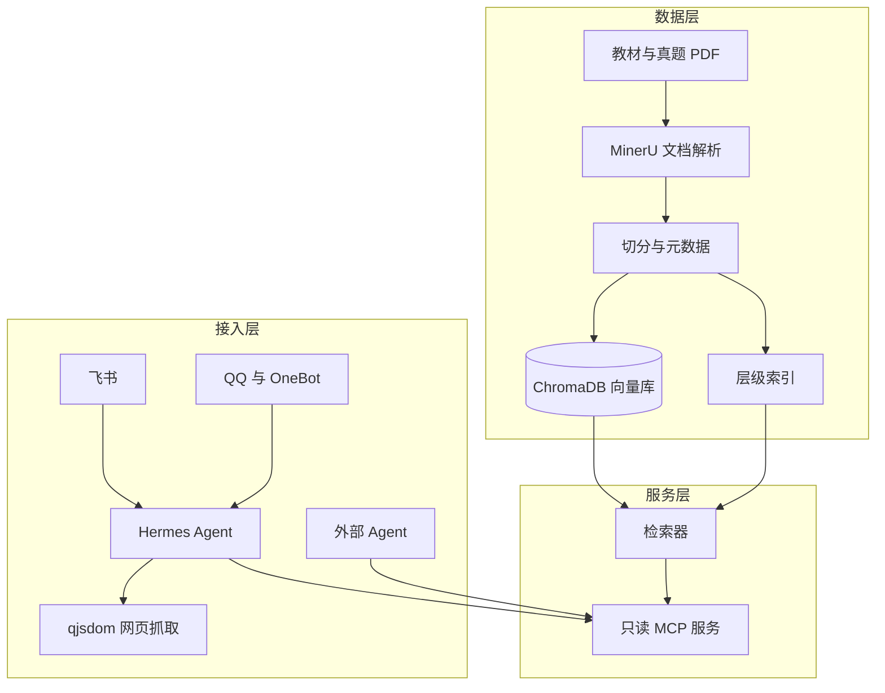

# 从 OCR 到向量数据库：面向考研的个人 AI 基础设施

## 系统概览

这套系统要解决的问题是：在 2 核 1.8 GB 的 VPS 上，把 7 本教材与历年真题转换为可检索、可引用的知识库，并使未安装任何软件的用户通过飞书或 QQ 使用检索能力。设计目标有三条：

1. 可入库。7 本教材与历年真题在 OCR 额度与磁盘容量内完成入库，流水线中断后可以从上次的位置继续。
2. 可检索。一次查询只执行一次远程 embedding，跨 50 个 collection 的真题库检索在 5 秒内返回。
3. 可对外。外部 Agent 只能通过只读 MCP 服务使用检索能力；平台侧接入飞书与 QQ。

系统各组件及其关系如下：



| 组件 | 职责 | 实现 | 章节 |
|---|---|---|---|
| 文档解析 | PDF 与 Office 文档转 Markdown 与 JSON | MinerU | 2.1 |
| 切分与入库 | 标题切分、元数据、写库 | `ingest.py` | 2.2、2.5 |
| 向量库 | 持久化与检索 | ChromaDB | 2.3、2.4 |
| 层级索引 | 文件行号到章节标题的映射 | 区间树与二分 | 2.6 |
| Agent 运行时 | 消息循环、工具、技能、定时任务 | Hermes | 3.1 |
| 平台接入 | 飞书与 QQ | 内置通道、OneBot 适配器 | 3.2 |
| 网页抓取 | 无浏览器的网页读取 | qjsdom | 3.3 |
| 对外检索 | 只读 MCP 接口 | `rag_readonly.py` | 3.4 |

规模与指标如下：

| 指标 | 数值 |
|---|---|
| 教材 | 7 本，5,127 页 |
| 文档总量 | 5,258 页，60 个 MinerU 任务，8,468 张图，1.9 GB |
| 向量库 | 9 个 collection、9,986 块；真题 48 个 collection、278 块 |
| 检索延迟 | 跨 50 个 collection 从 40 秒降至 2 至 5 秒 |
| 常驻任务 | 9 个定时任务；114 个技能，分布于 44 个分类 |
| 接入平台 | 飞书（线上）、QQ（开发分支） |
| 评测规模 | 37 个模型，5 张数据表，20 篇参考文献 |

第 1 节说明运行环境与资源约束，第 2 节说明从 OCR 到向量库的入库流程，第 3 节说明面向公共服务的扩展，第 4 节给出模型能力评测，第 5 节列出参考实现与开源范围，第 6 节是参考文献。

## 1 运行环境与资源约束

对于任何系统的建立而言，首要考虑的是外部资源的约束。运行环境决定了可选的技术栈，本节说明我们的计算环境。

| 项目 | 实测值 |
|---|---|
| 机型 | BandwagonHOST 洛杉矶 DC1 (NODESEEK-MEGABOX-PRO) |
| CPU | 2 核 (AMD EPYC-Genoa Processor) |
| 内存 | 1,857 MB |
| 磁盘 | 40 GB，已用 69% |
| 系统 | AlmaLinux 10.2，内核 7.2.9 |
| 常驻服务 | Hermes 网关 1 个，Docker 容器 4 个（helixblast、primer-evaluation、web-tfbs、um-react），另加 Caddy 与 Nginx 反向代理 |
| 工具链 | Go 1.25.1、Python 3.11.15、Node 22.23.2 |

由此可以归纳出三条基于计算资源的约束：

1. 内存。运行一个浏览器并渲染页面约需 1.5 GB[1]。本机内存为 1.8 GB，并启用了 zram，浏览器可以启动，但与常驻服务同时运行会挤占内存，因此不适合作为常驻抓取方案。该约束来自本机的资源分配，在个人计算机上通常不存在。资源允许时，Playwright 等 headless Chromium 方案对脚本渲染页面的支持更完整，见 3.3 节。
2. 磁盘。7 本教材经 OCR（光学字符识别）后的产物为 1.9 GB，其中图片 8,468 张、向量库 2.8 GB。若同时保留原始 PDF 与中间产物，将超出 40 GB 的磁盘容量。
3. 额度。OCR 使用 MinerU 的在线接口，每账号每天有 1,000 页的高优先级额度[2]；embedding 与 rerank 使用远程 API，每次检索均产生费用。上述两项限制要求流水线支持断点续跑，并要求检索调用次数少且结果准确。

三条约束与设计目标的对应关系如下：

| 约束 | 对应目标 | 落点 |
|---|---|---|
| 内存 1.8 GB，浏览器会挤占常驻服务 | 可对外：网页抓取不依赖浏览器进程 | 3.3 |
| 磁盘 40 GB，原始 PDF 与中间产物不能同时保留 | 可入库：只保留可检索的产物 | 2.1、2.2 |
| OCR 1,000 页/天，检索按次计费 | 可入库、可检索：断点续跑，一次查询只做一次远程 embedding | 2.3、2.4 |

## 2 从 OCR 到向量数据库

### 2.1 MinerU 文档解析

MinerU 是 OpenDataLab 开源的文档解析工具，可将 PDF 与 Office 文档转换为 Markdown 与结构化 JSON[3][4]。官方另维护一个生态仓库[5]，把网页入口、命令行、Python 与 Go 的 SDK、MCP 服务以及 LangChain 与 LlamaIndex 的集成集中在一处；`implementations/01-ocr-chunking/MinerU-接入指南.md` 按我们的用法把它整理成一张选择表。我们使用该工具处理教材与真题，因为其对扫描件、复杂版式、表格与公式的解析结果可直接使用，无需自行搭建 OCR 与版面分析流程。

在线接口的限制决定了文件切分方式：

| 限制项 | 标准接口 | 轻量接口 |
|---|---|---|
| 单文件大小 | ≤ 200 MB | ≤ 10 MB |
| 单文件页数 | ≤ 200 页 | ≤ 20 页 |
| 批量提交 | ≤ 200 个文件 | 不支持 |
| 每日额度 | 每账号 1,000 页按最高优先级处理 | 同左 |

若单个文件超过 200 页，接口返回错误码 -60006，提示「请拆分文件后重试」[2]。教材普遍超过 200 页，入库的 7 本教材均无法一次提交，页数最少的也有 458 页。

我们的做法是按章节边界切分 PDF，再逐份提交，边界取章或篇。理由见 2.2 节：块级元数据依赖标题，而标题依赖章节的完整性。

| 教材 | 页数 | MinerU 任务数 | 每个任务的页数范围 | 抽取图片 |
|---|---|---|---|---|
| 微生物学 | 458 | 3 | 73–198 | 555 |
| 现代分子生物学 | 465 | 3 | 113–186 | 605 |
| 遗传学 | 501 | 3 | 146–198 | 999 |
| 普通生物学 | 587 | 9 | 9–129 | 1,007 |
| Lewin 基因 X | 951 | 6 | 57–200 | 1,113 |
| 生物化学原理 | 966 | 8 | 4–195 | 1,716 |
| 生物化学 | 1,199 | 7 | 81–197 | 2,467 |

7 本教材合计 5,127 页、39 个 MinerU 任务、8,462 张图。加上真题与考试大纲，`docs/` 下共 5,258 页、60 个任务、8,468 张图、1.9 GB。

该切分方法可以推广到其他生物学教材。具体做法是：查阅目录，确定章或篇的起始页，以该页为边界切分；切分后确认每个文件不超过 200 页，若超过，则将对应章节按节进一步拆分。三类教材均可按此处理：分册出版的教材按上、下册切分，如《生物化学》；按篇组织的教材按篇切分，如《普通生物学》的绪论与七个部分；按章排列的教材每 3 到 8 章切分一次，如《微生物学》《遗传学》《现代分子生物学》。

有一个工程细节需要注意：MinerU 将每次任务的输出存放在 `<原文件名>-<uuid>/` 目录中，目录名保留了提交时写入的页码范围（如 `生物化学_上册_5-9.pdf`）。该页码范围是后续追溯内容来源的唯一依据，因为转换后的 Markdown 中章标题级别并不可靠，见 2.6 节。

### 2.2 文本切分

入库脚本采用两段式切分，参考实现见 `implementations/01-ocr-chunking/ingest.py`。

第一段按标题边界切分。脚本逐行扫描 `full.md`，将以 `# ` 开头的行识别为章标题、以 `## ` 开头的行识别为节标题，将两个标题之间的正文合并为一个逻辑块，并附加 `book`、`part`、`chapter`、`section` 四个元数据字段。第二段处理超长块：长度超过 `1500 × 1.3` 字符的逻辑块交由 LlamaIndex[6] 的 `SentenceSplitter` 按段落切分，块长 1,500 字符、重叠 200 字符，以避免句子被切断后语义不完整。

选择 1,500 字符有以下依据。教材的一节通常在 800 至 3,000 字之间，按节切分得到的块正好适合作为一次检索提交给模型的粒度；块更大则需要截断，截断会丢失上下文；块更小则同一论述会被拆分到两个块中。重叠 200 字符用于保留跨块的定义及其后续应用，例如「米氏常数」的定义与其后紧接的测定方法。

入库时跳过「名词索引」部分。索引条目是词语与页码的对照，写入库中只会干扰检索。

入库规模：9 个 collection、9,986 块；历年真题另建 48 个 collection、278 块。真题按年份建库，因为其结构是按年份与题型划分的零散记录，混合检索会造成相互干扰。

上述标题级别的假设在转换后的教材上并不成立，2.6 节将说明其处理方式。

### 2.3 ChromaDB 选型与两类故障

选择 ChromaDB[7] 的理由均来自本机约束：嵌入式运行，无需单独启动服务进程；持久化到本地目录，备份即复制目录；提供 Python 原生接口，LlamaIndex 已有适配层；单进程单库的检索延迟为毫秒级。对于内存仅 1.8 GB 的个人项目，上述四点比基准分数更重要。

代价是两类故障，我们均实际遇到。

第一类故障是持久化。ChromaDB 1.5.9 的写入路径是先将向量写入 `embeddings_queue` 表，累计达到 `sync_threshold`（默认 1,000）时才执行一次落盘；不足 1,000 的尾部记录仅保留在该表中。索引重建时队列会被回放，因此「检索结果正常」可能掩盖「向量从未落盘」的事实。更严重的情况是，若 collection 超过约 1,000 条，重启即发生损坏：HNSW（分层可导航小世界图）索引初始 `max_elements=100`，扩容到 2,048 后 C++ 侧写文件头用了新的 `max_elements_`，却没有同步扩展数据文件，重启读取越界。

这对应上游三个 issue：一个描述「干净退出时未跨过阈值就丢内存状态」（#6975）、一个描述「超过约 1,000 条后重启损坏」（#7090）、一个描述「没有公开 API 强制落盘」（#7463）[8][9][10]。修复仅存在于个人 fork 中，官方主线尚未合并。我们在 2026-10-20 通过 GitHub 接口核对过状态。三个 issue 均处于 open 状态：#6975 创建于 2026-04-25，#7090 创建于 2026-05-16，#7463 创建于 2026-07-18。「干净关闭时落盘」的 PR #7047 创建于 2026-05-11，仍未合并[11]。PyPI 上 chromadb 的版本仍是 1.5.9，发布于 2026-05-05[12]。即升级无法解决该问题，只能自行规避。

我们采用三种规避方法，均位于 `implementations/02-vectordb-ops/`：

1. 幂等 re-upsert 触发落盘。将已有记录原样读出后重新 upsert，使写入计数超过 1,000 阈值，从而触发一次实际的 `_persist()`。该做法在上游 #7463 的讨论中得到认可[10]。实测表明，Lewin 的 1,993 条记录确实落盘：`data_level0.bin` 从 4.2 MB（1,000 条容量）涨到 8.4 MB（1,993 条），pickle 记录的 total 从 1,000 变 1,993。
2. 从队列表恢复。有两个 collection 损坏到 `get()` 报错（`Morden_Molecular_Biology` 666 条、`Genetics` 613 条）。数据未丢失：`embeddings_queue` 里 `vector` 列是 4,096 字节，正好 1,024 维 float32，`metadata` 列含正文与元数据。按 `seq_id` 取出、重建 collection，并使用原 id 与原向量重新 `add`，chunk_id 自然保持一致。
3. 诊断先检查文件层。`col.count()` 是 SQLite 记录数，不等于 HNSW 实际落盘的向量数；`link_lists.bin=0` 对小型 collection 是正常现象。可靠的判据只有两条：检索是否实际返回，以及 `data_level0.bin` 的体积是否与文档数匹配。

该结论来自一次失败的处理：不应通过调小 `sync_threshold` 规避该缺陷。我们曾使用一份同行评审给出的配置调小阈值，结果每次写入都触发整段重写，26,000 条记录产生约 13,000 次重写，compactor 停止响应并产生十余个撕裂写窗口，结果更差。ChromaDB 本身也要求 `batch_size < sync_threshold`，默认的 100/1,000 是设计值。

第二类故障是元数据错位。`chapter` 字段存在大范围错误：朱圣庚《生物化学》的 2,165 块中有 370 块共用「第 1 章」的章名，杨荣武《生物化学原理》整本仅有两种取值；`section` 则基本正确。原因是 PDF 转 Markdown 时 h1 至 h4 被压缩为同一级别，脚本中「`# ` 为章、`## ` 为节」的假设不成立。

修改遵循一条原则：不改动旧字段，只新增字段。因为 chunk_id 是 `sha1(collection|chapter|section|text[:200])[:12]`，`chapter` 与 `section` 是哈希的输入，覆盖写入会使此前所有报告引用的 id 全部失效。若要修正，需要新增 `chapter_real` 等字段，旧字段保持不变。

### 2.4 embedding 与 reranker

我们使用阿里云百炼（DashScope）的 Qwen 系列，embedding 与 rerank 来自同一模型族。代码中的 embedding 模型为 `qwen3.7-text-embedding`，rerank 模型为 `qwen3-rerank`[13][14]。选择该模型族的理由有三条。中文教材的语义在这类模型上表现稳定，包括专业术语的中英文混排与 `$\lambda$` 等 LaTeX 转义。Qwen3-Embedding 支持 1,024 维与长上下文[15]，可完整容纳教材的一节。embedding 与 rerank 使用同一服务商，可减少一套计费与限流规则。

维度取自生产环境数据库中的元数据：9 个 collection 的现存向量均为 1,024 维。该值必须校验，因为维度不一致时检索会静默返回空结果而不报错。我们曾遇到一次：当时数据库中的向量为另一套维度，`query()` 直接抛出维度不匹配异常，两条检索路径均失效，只能全量重新 embedding。

检索成本模型决定了改造方向。原有实现对每个 collection 各执行一次远程 embedding，跨 50 个 collection 的真题库检索需要 40 秒。改造后，一次查询只执行一次 embedding，然后用 ChromaDB 原生的 `query_embeddings` 在本地逐库检索，最后执行一次远程 rerank，同一检索降至 2 至 5 秒。新路径与旧路径的等价性依赖两个前提。`distance` 转 `score` 必须使用 `exp(-distance)`，与 LlamaIndex 的 `ChromaVectorStore._query` 一致。构造 rerank 输入必须经由 `metadata_dict_to_node`；手工拼接 `TextNode` 会将 `document_id`、`_node_type` 等原始字段带入 rerank 文本，导致分数变化。

本地运行的可选方案。整套系统也可以离线运行，但本机无法满足：Qwen3-Embedding 的最小规格为 0.6B 参数，fp16 权重约 1.2 GB，而本机可用内存仅 548 MB。改用 CPU 量化推理可将内存占用降至数百 MB，代价是需要重新计算 9,986 个块，耗时会增加；该项我们没有在本地运行过，不给出数字。配置充足的机器（32 GB 内存、独立显卡）可在本地运行 Qwen3-Embedding 与 Qwen3-Reranker 的开源权重[15]。修改方法是将 `retriever.py` 中的 `DashScopeEmbedding` 与 `DashScopeRerank` 替换为 LlamaIndex 的本地同族实现，其余代码无需改动。

### 2.5 向量数据库的建立与检索

入库脚本与检索脚本构成这套系统的全部命令行接口，参考实现分别位于 `implementations/01-ocr-chunking/ingest.py` 与 `implementations/03-retrieval/`。

入库流程：扫描 `docs/<书名>/*/full.md`，按 2.2 节切分，写入 collection。collection 的 `hnsw:space` 固定为 `cosine`，写入按每批 50 条执行，一是控制单次请求的内存峰值，二是提高落盘触发频率。此处的 50 与前述 `sync_threshold` 的 1,000 并不冲突，前者是 API 批次大小，后者是持久化阈值。

供 Agent 使用的检索接口是一个命令行工具，输出结构化 JSON，每条结果包含 `chunk_id`、collection、书、章、节、分数与全文：

```
./.venv/bin/python kb_search.py "糖酵解 三个限速酶" --collection Principle_of_Biochemistry_Yang_RongWu --top-k 5 --rerank 5
```

有三个设计细节根据实际运行中遇到的问题确定：

`chunk_id` 稳定可复算，因此引用可由程序校验。取块全文由另一个脚本按 id 前缀直接定位数据库，只查询一个库，约 2 秒。

`--top-k` 与 `--rerank` 是两个独立参数。需要 5 条结果时必须同时传入 5；只传前者时，rerank 会按默认值返回不超过 5 条的结果，且不报错。该规则已写入提供给模型的工具描述。

真题库与课本库分别检索，因为二者位于不同目录（`chroma_db` 与 `chroma_exam_db`），一次只能指定一个。需要同时查询两个库时，调用两次。

### 2.6 章节层级的重建与二分查询

2.2 节留下的问题是：入库时的 `chapter`、`section` 由标题级别推断，而标题级别在 PDF 转 Markdown 时丢失。后果明确：引用一条检索结果时，模型与人均无法确定其所属章节，而考研复习正是按章、按节组织。

重算 metadata 会使所有既有引用的 id 失效。我们保留入库脚本与既有 id，从 Markdown 原文重建层级，建立文件行号到章节标题的只读映射，不修改 chroma 数据。方案分为三步：

1. 从每本教材的 `full.md` 中提取标题并分类。该步的关键是先将「栏目」从层级中排除：关键概念、综述文献、小结、参考文献、考试要求、习题、图注、题型名均不属于章或节。若不排除，目录树会被「小结」这类重复出现十余次的栏目标题干扰。排除后，全库未识别率从 25% 降至 2.0%（10 本教材共 8,656 个节点，其中 172 个未识别）。

2. 建立有序区间树。每个节点记录 `{text, kind, level, start, end, parent}`，按起始行号升序存为数组。建树使用栈：新节点进入时，将栈中级别不低于它的节点全部弹出并闭合区间（将 `end` 设为新行号减一），此时栈顶即为其父节点。这样每个节点的区间恰好覆盖到下一个同级或更高级标题的前一行。

3. 二分查询。给定行号，`bisect_right(starts, line) - 1` 得到的节点必然包含该行，再沿 `parent` 上溯即可得到完整标题链，如「第 17 章 六碳糖的分解和糖酵解作用 > 八、糖酵解作用的调节 > （三）己糖激酶和丙酮酸激酶对糖酵解的调节作用」。查询复杂度为 O(log n)，上溯为 O(1)。点查询使用有序数组加二分即可。

将 chunk 映射到行号是唯一的工程难点：不能用标题文本查表，因为「小结」出现 13 次，重复标题会全部指向第一次出现的位置；处理方法是取 chunk 正文前四行作为锚点，从长到短在本书的 `full.md` 中执行 `find`（长锚点歧义更小），再把字符位置转换为行号：

```
anchor = "\n".join(前四行非空行)[:260]   # 匹配不上时依次退到三行、两行、单行
pos = full.find(anchor)
line_no = full.count("\n", 0, pos) + 1
```

实测未定位的块为 0：9,986 块中的 9,672 条唯一 id 全部定位成功（差额来自 chunk_id 的固有碰撞：前 200 字与章节名均相同的两个块会生成相同 id，这由原设计决定）。其中 1,138 条（11.8%）属于同一段文字在多份页码重叠的分册里同时命中，生成器按文件名排序取第一份，保证同一输入得到同一输出。锚点搜索限定在该教材目录内，查询较快且不会跨书误命中。

输出为两个文件：`toc_index.json`（每本教材的节点数组，约 1.1 MB）与 `chunk_loc.json`（chunk_id 到行号与标题链，约 5 MB），可常驻内存。生成端与查询端在 `implementations/04-locating/`，34 个单元测试覆盖分类、章号合并、区间树与锚点定位，全量生成耗时 12 秒。

现状与合并路径。该索引仍是离线数据，检索工具尚未将 `location` 加入返回值，因此需要人工使用。这属于已知的技术债，也解释了 2.2 节的「入库脚本按标题推断元数据」与本节的「从原文重建层级」为何是两种做法：

- 方案一：入库脚本改用层级索引的结果填写 `chapter_real`、`section_real`。代价是需要重新执行一次全量入库，但 id 不变，引用安全。
- 方案二：不改动数据库，只在检索返回值中附加 `location`，并要求模型以 `location` 作为引用字段。代价是每次检索增加一次 O(log n) 查表与 5 MB 常驻内存，收益是零写操作、零迁移风险。

我们倾向方案二，因为其失败影响最小；方案一可使所有下游工具无需改写，长期维护成本更低。两种方案均尚未实施。

## 3 面向公共服务的扩展

### 3.1 Hermes 的组成

上层是一个常驻的 Agent 运行时 Hermes Agent[16][17]，它将「接收消息、决定动作、调用工具、返回消息」的循环封装为服务。本项目涉及其中四个部件：

- 网关与平台适配器：网关是一个 systemd 用户服务，负责将消息平台的事件转换为 Agent 的输入，并将回复返回平台。平台以插件形式实现，飞书为内置通道，QQ 使用我们的 OneBot 适配器（见 3.2 节）。更换平台不需要修改 Agent 本体。
- 工具与 MCP（模型上下文协议）：工具包括内置工具（文件、终端、网页、浏览器），也可以实现为 MCP 服务接入。本机运行 3 个 MCP 服务：两个模型直连服务（供流水线中的子进程使用），一个复习卡片服务。
- 技能与记忆：技能是面向人阅读的操作手册，Agent 按任务类型加载；记忆分为两层，一层常驻（用户身份、环境事实），一层按需检索。上述机制使「考点分析」这类流程不必每次重新说明。
- 定时任务与委派：本机运行 9 个定时任务，包括每天四次的知识卡片推送。委派是将子任务交给另一个模型在隔离上下文中执行，用于避免大批量检索与分析占用主对话。

飞书与 QQ 两个连接器的形态不同，对照如下。该表说明了「更换平台不需要修改 Agent」的具体含义。

| 项目 | 飞书 | QQ |
|---|---|---|
| 接入方式 | 应用凭据 + 长连接事件订阅 | OneBot v11 反向 WebSocket |
| 代码位置 | 网关内置通道 | 独立平台插件（见 3.2 节） |
| 上线状态 | 线上运行 | 开发分支，未安装到 profile |
| 消息形态 | 富文本卡片、图片、文件 | CQ 字符串或段数组、图片、语音 |
| 主要约束 | 应用权限范围 | 群白名单与令牌 |

规模：114 个技能，分布于 44 个分类；40 个会话存档；安装目录 6 GB。

### 3.2 OneBot 适配器

QQ 接入采用 OneBot v11 协议[18]，因为 NapCat、Lagrange、go-cqhttp、LLOneBot 等实现均提供同一种反向 WebSocket 接口，更换实现不需要修改适配器。适配器已开源：`credits-infra/hermes-qq-onebot`，MIT 许可[19]。

它是 Hermes 的平台插件，实现 OneBot v11 的反向 WebSocket 服务端。加固项均配有回归测试：

| 加固点 | 处理 |
|---|---|
| 动作白名单 | 仅允许插件所需动作，其余拒绝 |
| 握手鉴权 | 认证通过才接管连接；非回环监听强制要求令牌 |
| 群白名单 | 未列入白名单的群不响应；群内须 @ 机器人才触发 |
| CQ 码净化 | 入站 CQ 字符串解析前净化，防注入 |
| 媒体路径 | 仅允许白名单目录，防路径遍历（嵌套列表须递归检查） |
| 出站目标 | 校验目标地址，不允许向任意主机发送消息 |

到 2026-10-20 为止，`harden-security` 分支上有 69 个提交，补丁系列另归档为 40 个 patch 文件；13 个测试脚本共 300 条判定，当日实测 0 失败（由 Hermes 运行时的 Python 执行，脚本自身不需要联网）。本轮加固未引入回归。

有一点需要澄清：我们没有修改 LLOneBot 本体。本地的 `LLOneBot/LuckyLilliaBot`[20] 仓库克隆自上游，与上游 main 相比没有自有提交，全部历史仅有上游作者的一个提交。我们修改的是客户端侧的兼容层，已逐项对照 LLOneBot 源码核对。核对结论有五条：

- 插件用到的 11 个动作全部支持。
- `friend_poke` 与 `set_msg_emoji_like` 两个扩展动作的参数名与实现一致。
- 反向 WebSocket 握手请求头中读取 `X-Self-ID`（机器人 QQ 号）作为会话标识。
- `messageFormat` 为 `array` 与 `string` 两种形态均支持。
- 未实现的动作按 OneBot 约定返回 `retcode 1404`。

此外还处理了一个实现细节：LLOneBot 发送图片时取 `url || file`，因此判断媒体段是否为危险路径时，仅检查 `file` 字段会产生误判。

该适配器仅存在于开发分支，未安装到任何 profile。线上运行的是飞书通道。

### 3.3 基于 qjsdom 的网页抓取

Agent 需要读取网页。页面抓取的常规方案是 Playwright 等 headless Chromium 工具，对脚本渲染页面的支持更完整。本机的内存余量不足以长期运行浏览器进程，因此实现了 qjsdom：使用 Wazero 运行编译为 WebAssembly 的 QuickJS 作为脚本引擎，使用 linkedom 提供 DOM，全部组件编译为一个 Go 静态二进制，不依赖 Node 或浏览器进程[1]。在资源允许的环境中应优先采用 Playwright 一类方案，qjsdom 是本机约束下的替代实现。仓库 `credits-infra/qjsdom` 已开源，截至 2026-10-20，`main` 分支有 92 个提交。

它提供四种提取模式，由调用方声明意图，工具不做自动判断：`all`（整页文本与链接）、`article`（按固定优先级提取正文容器）、`links`（仅输出链接；搜索页与目录页的「正文」即为链接）、`static`（不建立脚本运行时，仅解析 HTML）。

`static` 模式是后续版本增加的，效果超过预期。同一台机器上的实测，RSS 指进程的常驻内存集大小：

| 页面 | 模式 | 耗时 | 进程峰值 RSS | 正文 |
|---|---|---|---|---|
| 维基百科「糖酵解」 | static | 0.156 s | 18.2 MB | 17,714 字 |
| 同上 | article | 4.325 s | 147.9 MB | 17,109 字 |
| DuckDuckGo 搜索结果页 | static | 0.744 s | 16.9 MB | 4,874 字 |
| 同上 | links | 1.997 s | 89.0 MB | 5,061 字 |
| quotes.toscrape.com/js/ | static | 0.272 s | 16.9 MB | 82 字 |
| 同上 | all | 1.798 s | 79.2 MB | 1,480 字 |

服务端常驻时的差别更大。MCP 模式串行 5 次请求同一页面：默认模式每次 4.3 秒、稳态 RSS 38.4 MB、进程内峰值 144.1 MB；`static` 模式每次 66 到 80 毫秒、稳态 14.9 MB、峰值 19.1 MB。4 并发时默认模式峰值 392.5 MB、单请求 9 到 12 秒，`static` 峰值 26.7 MB、单请求 88 到 193 毫秒。可见在 1.8 GB 的机器上，决定是否发生 OOM 的是并发时的峰值内存。

静态路径有适用范围，我们也测试了其边界：从 `article` 正文中抽取 20 个等距的 120 字片段，统计其中能在 `static` 文本中原样找到的比例。维基百科为 100%，MDN 为 95%，VitePress 文档为 90%，而使用 `document.write` 生成正文的页面为 0%。服务端渲染与静态生成的站点基本无损，依赖脚本渲染的页面只能获得初始 HTML，因此静态路径仅作为可选加速手段，不作为默认行为。

MCP 接入中有三个问题需要说明：

1. 不要自行对图片内容块执行 base64 编码。go-sdk 的 `ImageContent.Data` 声明为 base64，实际存放原始字节，SDK 会代为编码。手工再编码一次会形成双重编码：客户端解码一次后得到 ASCII 文本，判定为非图片并直接丢弃，而工具调用仍显示为成功。
2. 内容块没有标签。`ImageContent` 没有 alt 与 name，调用方只能按位置对应，而中间每一跳都可能改变位置。我们的做法是在正文末尾附加一份编号清单，逐条给出 URL、格式、像素尺寸与本地路径，让模型按 URL 语义选择。
3. 过滤应按像素尺寸执行。一篇维基文章抽出 87 张图，其中 60 张是图标；四个化学结构图仅 1.9 至 3.7 KB，按字节过滤会先将其删除，而 13.4 KB 的站点头图反而保留。

### 3.4 本地向量库的对外检索服务

这套系统原本仅服务单个用户。要使未安装任何软件的用户也能使用，需要三部分：本地向量库、只读 MCP 桥，以及一个能从即时通信平台接入的 Agent 运行时。

我们以 DeepSeek Harness（下称 dsh）为例。dsh 在这一层的角色与 3.1 节的 Hermes 相同，都是常驻的 Agent 运行时，负责接收消息、调用工具并返回结果。QQ Bot 接口由腾讯提供。`tencent-connect/dsh-qqbot`[21] 是腾讯为 dsh 实现的连接器插件，面向个人用户，用于通过 QQ 等即时通信平台接入 dsh，以 MIT 许可发布。安装到 dsh 的 profile 并扫码绑定后，即可在 QQ 私聊与群聊中与 dsh 对话：

```
npx @deepseek-ai/dsh plugin --profile qqbot add @tencent-connect/dsh-qqbot
npx @deepseek-ai/dsh --profile qqbot
```

首次启动时，插件检测到凭据未配置会进入扫码引导；凭据保存在 profile 中，后续启动不再扫码。消息路径为：QQ 用户经 WebSocket 进入插件，插件将消息交给 dsh 的 agent loop，回复再以 QQ 的 Markdown 消息发回。

同类运行时还有腾讯的 WorkBuddy；本报告只以 dsh 为例，因为其插件安装与扫码绑定只需数条命令，复现成本最低。

此处的关键设计是桥接层：向外部 Agent 暴露本地检索能力，同时不开放整台机器的控制权。我们的实现是一个只读 MCP 服务（`implementations/05-agent-infra/rag_readonly.py`），设有五条约束：

| 约束 | 实现 |
|---|---|
| 只读 | 仅暴露检索与取块，不提供写入、shell、任意命令或任意文件路径入参 |
| 库白名单 | 课本 7 库、考纲 2 库与真题库；自编手册不包含在内 |
| 防注入 | 子进程以列表形式传递 argv，使用 `shell=False`，查询词作为单个参数传递 |
| 限额 | 查询 ≤ 500 字符，`top_k` ≤ 10，单块返回 ≤ 900 字符，子进程超时 120 秒 |
| 路径受限 | 正文类工具仅返回库内字段，不返回文件系统路径；插图工具仅返回白名单目录内的绝对路径 |

桥接服务与被桥接的检索端需要安装在不同的 Python 环境中：MCP 服务运行在安装了 `mcp` 库的解释器中，实际检索交由向量库自身的 venv 子进程执行。这样安排有具体原因：将 `chromadb` 与 `llama-index` 安装到主运行时会与其 `pydantic` 依赖冲突，导致主 Agent 的检索工具一并失效。子进程还需要清除 `PYTHONPATH` 与 `PYTHONHOME`，否则错误信息会表现为「库损坏」。

提示模型的两条规则来自实测：

模型会混淆「无法取得」与「取得后主动放弃」，因此工具的错误消息需要明确排除权限解读，两个条数参数都必须显式传入。真题库按年份存储判断题答案序列、名词解释列表等零散记录。为避免模型将这些记录作为完整试卷输出，工具返回结果中包含 `caveat` 字段。

## 4 模型能力评测

本节仅列出测量结果。测试对象是委派给子代理的模型；所有任务均有一份人工复核过的标准答案（ground truth，下称 GT），任务书逐字相同，仅更换被测模型。

方法上有四条原则，决定这些数字的可信度：

- GT 必须从被测数据源实测重建，不能沿用历史记录。我们曾按一份未经复核的记录为 25 题打分，后经实测为 24 题，该轮所有分数作废。
- 判定标准需预先写入任务书。任务书中写入判定规则，GT 数字仅由主进程保留，否则模型会按目标数字反推答案。
- 控制变量按影响程度依次尝试：结构化小步任务书优先，强约束模板次之，关闭思考模式最后。关闭思考模式仅对「思考导致过度纳入」的情形有效，对「单次输出过长导致停滞」的情形反而使精度下降。
- 子代理自报的引用校验不可信，必须由主进程使用独立验证器对全库重新校验。

表 1 脂代谢判断题筛选（GT=25 题，2026-10-01）

| 模型与配置 | 耗时 | 计数 |
|---|---|---|
| deepseek-v4.1-flash（基线） | 81 s | 25/25 |
| mimo-v2.6-flash，默认 | 844 s | 25/25 |
| mimo-v2.6-flash，关思考 | 470 s | 24/25 |
| mimo-v2.6-flash，加小步任务书 | 407 s | 25/25 |
| space-bunny-free，原始任务书 | 110 s | 23/25 |
| space-bunny-free，加小步任务书（带提示） | 50 s | 25/25 |
| space-bunny-free，加小步任务书（无提示） | 68 s | 25/25 |
| gpt-6-luna，原始任务书 | 56 s | 23/25 |
| gpt-6-luna，加小步任务书 | 73 s | 25/25 |
| muse-spark-1.3-contributor，原始任务书 | 98 s | 25/25 |
| Ling-3.1-flash，关思考 | 112.7 s | 25/25 |
| Ling-3.1-flash，开思考 | 300.4 s | 25/25 |
| step-5-preview，原始任务书 | 1,510 s | 24/24（GT 修正版） |

注：最后一行的评测使用修正后的 GT（24 题），其计数与其他行不可直接比较。

表 2 五模型 RAG 检索生成压测（真核基因表达调控五层面，2026-10-02）

| 模型 | 条目 | 去重引用 | 伪造引用 | 检索次数 | 耗时 | API 调用 | 汉字数 |
|---|---|---|---|---|---|---|---|
| deepseek-v4.1（基线） | 67 | 70 | 0 | 16 | 547.9 s | 20 | 6,538 |
| Ling-3.1 | 38 | 65 | 0 | 15 | 273.5 s | 9 | 6,582 |
| space-bunny-free | 106 | 80 | 1 | 18 | 917.9 s | 42 | 22,083 |
| muse-1.3-contributor | 31 | 45 | 0 | 10 | 345.1 s | 21 | 3,984 |
| mimo-v2.6-flash | 40 | 47 | 0 | 10 | 735.4 s | 14 | 8,248 |

表 3 命题流水线 A/B（糖类模式三卷，2026-10-02）

| 指标 | space-bunny-free | deepseek-v4.1-flash |
|---|---|---|
| 墙钟时间 | 3,057 s | 659 s |
| Supervisor API 调用 | 100（达到上限） | 19 |
| 脚本报错 | 约 10 次（含一次 300 s 死循环） | 0 |
| 交付 | 73 题 / 107 分 | 72 题 / 100 分 |
| 终验 | 全部通过（修复一处后） | 全部通过（一次通过） |
| 返工 | 因覆盖缺口在末端返工，约 18 次迭代 | 一处溯源章号修正 |

表 4 协议可用性矩阵（37 个模型，2026-10-16）

| 类别 | 数量 | 说明 |
|---|---|---|
| chat/completions 可用 | 28 | glm、deepseek、mimo、qwen、kimi、minimax、bunny、step、longcat、hy 等 |
| responses 可用 | 8 | gpt-6-luna、gpt-5.6-luna、grok-4.6/4.7、muse 系、deepseek 系 |
| messages 可用 | 13 | claude-haiku-5-5、qwen 系、kimi-k3、minimax、bunny、deepseek 系 |
| 三协议全不通 | 1 | gemini-4-argon-contributor（该端点） |

注：同一模型可以支持多个协议，四行计数之和是 50，大于模型数 37。

上述几轮观察可以合并分析，任务书相同：

- 小步任务书对生成停滞型模型：844 s 降至 407 s，计数仍为 25/25。
- 小步任务书对通读后漏题的模型：23/25 升至 25/25，耗时从 110 s 降至 68 s。
- 关闭思考模式对过度纳入型模型：误收题数从 467 题降至 7 题（历史数据，2026-08）。
- 关闭思考模式对生成停滞型模型：提速 44%，但计数从 25 降至 24。

表 5 引用校验的必要性（2026-10-02 与 10-11 两组）

| 情形 | 结果 |
|---|---|
| space-bunny-free 自检声称伪造 0 条 | 主进程全库重算发现 1 条：hash 值正确、书名前缀与内容不符 |
| 抽样人工核对 5 模型各 2 条 | 10/10 溯源吻合 |
| step-5-preview 重任务 | 上游返回 504，1,775 s 后失败 |

上述数字仅描述这几次运行，不构成对模型的推荐。被测模型会更新，结论仅在标注日期内有效。

## 5 参考实现清单

参考实现位于 `implementations/`，按用途分为六类。它们与我们的生产环境深度耦合：路径、库名、collection 命名均包含具体教材与目录结构；部分脚本还依赖本机特有的服务（向量库 venv、DashScope 凭证、真题库）。因此全部按「复用前需修改路径与凭证」的前提整理，代码中的个人路径已替换为占位路径，密钥仅以环境变量名出现。

| 目录 | 内容 | 依赖 |
|---|---|---|
| `01-ocr-chunking/` | 入库脚本：标题切分、超长块处理、元数据、批量写入 | chromadb、llama-index、DashScope |
| `02-vectordb-ops/` | 诊断与修复：全库诊断、幂等 re-upsert 触发落盘、从队列表恢复、落盘验证 | chromadb |
| `03-retrieval/` | 检索组件：检索器、命令行工具、按 id 取块 | chromadb、llama-index、DashScope |
| `04-locating/` | 层级索引的数据格式、二分查询方案与查询示例 | 只读，无外部依赖 |
| `05-agent-infra/` | 只读检索 MCP 服务（脱敏节选） | mcp |
| `06-baselines/` | 第 4 节的基线数据表（CSV） | 无 |

未开源部分说明理由：教材与真题的原始 PDF、OCR 产物（1.9 GB）、向量库（2.8 GB）均涉及版权，不纳入仓库；`.env` 中的 API 凭证、飞书与 QQ 凭据不纳入仓库；每日卡片流水线包含个人复习进度与错题记录，仅保留结构说明。

## 6 参考文献

[1] EndCredits, et al. qjsdom: read web pages without a browser or Node runtime[CP/OL]. [2026-10-20]. https://github.com/credits-infra/qjsdom.

[2] MinerU. 文档解析接口文档[EB/OL]. [2026-10-20]. https://mineru.net/apiManage/docs.

[3] OpenDataLab. MinerU: a PDF extraction tool for LLM-ready data[CP/OL]. [2026-10-20]. https://github.com/opendatalab/MinerU.

[4] OpenDataLab. MinerU documentation[EB/OL]. [2026-10-20]. https://opendatalab.github.io/MinerU/.

[5] OpenDataLab. MinerU-Ecosystem: the official ecosystem toolkit for MinerU Open API[CP/OL]. [2026-10-21]. https://github.com/opendatalab/MinerU-Ecosystem.

[6] LlamaIndex. LlamaIndex documentation[EB/OL]. [2026-10-20]. https://docs.llamaindex.ai/.

[7] Chroma. Chroma: search infrastructure for AI[CP/OL]. [2026-10-20]. https://github.com/chroma-core/chroma.

[8] Chroma. Issue #6975: PersistentLocalHnswSegment loses in-memory state on process exit when sync_threshold not crossed[EB/OL]. (2026-04-25)[2026-10-20]. https://github.com/chroma-core/chroma/issues/6975.

[9] Chroma. Issue #7090: HNSW index not surviving server restart in C/S mode when collection exceeds ~1000 embeddings (ChromaDB 1.5.9)[EB/OL]. (2026-05-16)[2026-10-20]. https://github.com/chroma-core/chroma/issues/7090.

[10] Chroma. Issue #7463: No public API to force HNSW persistence: index stays WAL-only until sync_threshold[EB/OL]. (2026-07-18)[2026-10-20]. https://github.com/chroma-core/chroma/issues/7463.

[11] Chroma. Pull request #7047: Persist HNSW state on clean shutdown[EB/OL]. (2026-05-11)[2026-10-20]. https://github.com/chroma-core/chroma/pull/7047.

[12] Python Package Index. chromadb 1.5.9[EB/OL]. (2026-05-05)[2026-10-20]. https://pypi.org/project/chromadb/.

[13] 阿里云. 百炼大模型服务平台 API 参考[EB/OL]. [2026-10-20]. https://help.aliyun.com/zh/model-studio/qwen-api-via-dashscope.

[14] 千问 AI 平台. DashScope rerank 接口文档[EB/OL]. [2026-10-20]. https://platform.qianwenai.com/docs/api-reference/rerank/dashscope-rerank.

[15] Qwen Team. Qwen3-Embedding[CP/OL]. [2026-10-20]. https://github.com/QwenLM/Qwen3-Embedding.

[16] Nous Research. Hermes Agent documentation[EB/OL]. [2026-10-20]. https://hermes-agent.nousresearch.com/docs.

[17] Nous Research. Hermes Agent[CP/OL]. [2026-10-20]. https://github.com/NousResearch/hermes-agent.

[18] OneBot. OneBot v11 标准[EB/OL]. [2026-10-20]. https://github.com/botuniverse/onebot-11.

[19] EndCredits, et al. hermes-qq-onebot: Hermes Agent OneBot 适配器[CP/OL]. [2026-10-20]. https://github.com/credits-infra/hermes-qq-onebot.

[20] LLOneBot. LuckyLilliaBot: 支持 OneBot 11、Satori 和 Milky 协议[CP/OL]. [2026-10-20]. https://github.com/LLOneBot/LuckyLilliaBot.

[21] 腾讯. dsh-qqbot: 让 QQ Bot 接入 DeepSeek Harness 的官方插件[CP/OL]. [2026-10-20]. https://github.com/tencent-connect/dsh-qqbot.
